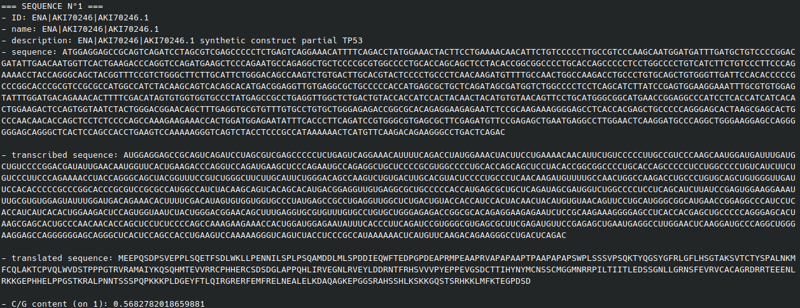

=== INFORMATION ===

- Python script that displays the basic functionalities of Biopython.
- It shows all DNA sequences contained in a .fasta file, displaying their id, name and details.
- For each one of them, it also shows the respective transcribed mRNA, the respective translated proteic sequence and the C/G fraction content.

=== HOW TO DOWNLOAD/INSTALL ===
1) Click on the "<> Code" button and select "Download ZIP".
2) Extract the downloaded archive.
3) Open a terminal in the extracted folder and execute:
   (on Windows:) "python -m venv venv", followed by: "venv/Scripts/activate", followed by: "pip install -r requirements.txt".
   (on MacOS:) "python3 -m venv venv", followed by: "source venv/bin/activate", followed by: "pip install -r requirements.txt".
   (on Linux:) "python3 -m venv venv", followed by: "source venv/bin/activate", followed by: "pip install -r requirements.txt".

=== HOW TO USE ===

1) Download the sequence you want to analyze (as a .fasta file) from a public database such as NCBI or EMBL.
2) Move the file into the program's directory and rename it as "seq.fasta".
3) Execute "GeneTool.sh" in a terminal.

=== CONTENT ===

- GeneTool.sh      the main executable file
- mainscript.py    the python script that does the analysis
- README.md        informations about this program (you can remove it)
- requirements.txt file required to install dependencies (you can remove it once installed)
- screenshot.png   illustrative screenshot (you can remove it)
- seq.fasta        test example (you can remove it)

=== NOTES ===

- This program works in a virtual environment that includes the following Python libraries:
  - pandas
  - biopython

=== SCREENSHOTS ===

Results example:

